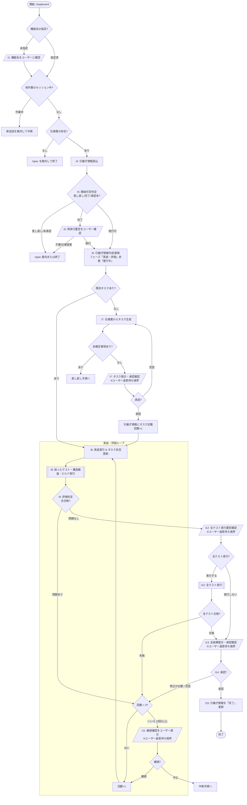

# 実装・評価

対象: $ARGUMENTS

## 全体フロー

## 対話・行動プロトコル（誤認防止ルール）

1. **現在ステップ宣言**: ユーザーへメッセージを返すときは、冒頭に必ず `[Step: I番号 (ステップ名)]` を明記すること（例: `[Step: I7 (タスク提示・承認確認)]`）。
2. **停止境界（Barrier）の遵守**: `[/ ... /]` で示された対話ノード（I1, I5, I7, I11, I12, I13）では、ユーザーへの質問・提示を出力した時点でターンを終了し、ユーザーの返答を待つこと。ユーザーの返答がないまま実装や完了へ独断で進めてはならない。
3. **客観的エビデンスの義務化**:
   - I9 では必ずツール実行（`run_command`）で絞ったテスト（`./scripts/test.py`）、構造検査（`./scripts/lint_code.py`）、ビルド（`./scripts/build.py`）を実行し、その結果ログを確認すること。
   - 構造検査・ビルドの成功エビデンスなしに承認（I13）を求めてはならない。
4. **副次成果物の同期**: タスクの進捗状況や評価結果・実行履歴は、タスク完了および評価完了ごとに必ず引継ぎ情報（`docs/ai/<feature>.md`）へ即座に反映すること。

## 各ステップの実行規約

### 準備・状態確認 (I1〜I6)

- **I1 (機能名確認)**: 対象が未指定のときは、ユーザーに機能名を確認する。
- **I2 (セッション確認)**: このセッションで他の機能やフェーズの作業をしているときは、新しい会話(コンテキストの初期化)を案内して、中断する。
- **I3 (仕様書確認)**: 仕様書がないときは、`/spec` を案内して、終了する。
- **I4 (引継ぎ情報読込)**: `./docs/ai` に対象機能の引継ぎ情報があれば読み込む。なければ I6 で作成する。
- **I5 (開始可否判定)**: 引継ぎ情報の内容から、実装・評価を開始してよいか判断する。
  - 状態が「差し戻し」: `/spec` を案内して終了する。
  - フェーズが「仕様作成」で状態が「完了」、またはフェーズが「実装・評価」で状態が「進行中」「中断」: 続行する。
  - フェーズが「実装・評価」で状態が「完了」: 完了済みであることを伝えて再実行が必要か確認する（不要なら終了、仕様変更なら `/spec` 案内して終了、それ以外は続行）。
  - 上記以外(引継ぎ情報がない場合を含む): 仕様書が承認済みかをユーザーに確認する（承認済みなら続行、未承認なら `/spec` 案内して終了）。
- **I6 (引継ぎ情報作成/更新)**: 引継ぎ情報がなければ `./docs/_template/handover.md` から作成する。既存の場合も含めて、フェーズを「実装・評価」、状態を「進行中」にする。

### タスク生成・承認 (I7)

- **I7 (タスク生成 & 承認)**:
  - 引継ぎ情報に実装・評価のタスクがあるときはそれを使用して再開位置から続け、回数と実行履歴も引き継ぐ（**I8** へ）。
  - タスクがないときは、機能仕様書・関連画面・関連 API の仕様書を読み込んでタスクを生成する。
    - 実装タスク: 配置(`docs/app.md` の「ソフトウェア構造」に従った層・モジュール・共有の再利用)を含める。
    - 評価タスク: 必ず「構造検査(`./scripts/lint_code.py` が成功する)」と「ビルド(`./scripts/build.py` が成功し実行ファイルが生成される)」を含める。
    - 実装済みの内容があれば仕様書と照合して状況に反映し、仕様と異なる実装は修正タスクにする。
  - 引継ぎ情報の未確定事項に「未確認」が残っているときは、**差し戻しの手順**に進む。
  - 生成したタスクをユーザーに提示して承認を求める（※停止境界）。承認されなければ修正して再提示。承認されたら引継ぎ情報に記載し、回数を 1 にして **I8** に進む。

### 実装・評価ループ (I8〜I11)

- **I8 (実装実行)**: タスクの実装手順に従って実装する。タスクが完了するごとに、引継ぎ情報の状況を更新する。
- **I9 (評価実行: ツール実行 & 判定)**:
  - テストを必要な範囲に絞って実行（標準は `./scripts/test.py -f <feature-name>`、バックエンド/UI のみなら `--backend` / `--ui` 併用、失敗テスト再実行は `-k` や `--lf`）。
  - 構造検査(`./scripts/lint_code.py`)とビルド(`./scripts/build.py`)を必ず実行する。どちらかが失敗したときは問題ありとする。
  - 結果(実行したテストの範囲を含む)は、引継ぎ情報の実行履歴に記載する。
- **I10 (問題発生時の回数判定)**: 問題があるとき（I14 で承認されなかった場合を含む）、回数が 3 未満なら回数を 1 加算して **I8** に戻る。
- **I11 (上限到達時の継続確認)**: 問題があるときで回数が 3 以上のときは、ユーザーに続けるか確認する（※停止境界）。続けるなら回数を 1 加算して **I8** に戻る。続けないなら**中断の手順**に進む。

### デグレ確認・承認・完了 (I12〜I15)

- **I12 (全テスト実行確認)**: 問題がなければ、デグレ防止のために全テスト(`./scripts/test.py`、引数なし)を実行するかを、「実行する」「実行しない」の選択肢で確認する（※停止境界）。実行して失敗があれば問題ありとして **I10** に進む。
- **I13 (成果提示・承認確認)**: 実装・評価の結果(構造検査・絞ったテスト・全テスト(実行した場合)・ビルド結果)をユーザーに提示し、承認を求める（※停止境界）。ビルドが未実行のときは承認を求めてはならない。
- **I14 (承認判定)**:
  - 承認されなければ、指摘内容を確認して **I10** に進む。
  - 承認されたら **I15** に進む。
- **I15 (完了更新)**: 引継ぎ情報の概要、関連資料、引継ぎ(引継ぎ元、最初にやること)を更新し、状態を「完了」にして終了する。

## 承認の取り方

- 「承認」と「修正が必要」の選択肢で確認する。
- 選択肢以外の曖昧な返答は、承認とみなさず、選択肢で再確認する。

## 差し戻しの基準

- **差し戻す**: 仕様書に記載がなく、実装結果(入力・出力・業務規則・異常規則・振る舞い)が変わる判断が必要なとき。仕様書の矛盾・不備があるとき。
- **差し戻さない**: 実装結果に影響しない詳細(変数名、内部構造など)は、実装で決める。

## 差し戻しの手順

差し戻しの基準に該当するときは、次の手順で差し戻す。

1. 実装・評価を中断する。
2. 引継ぎ情報の状態を「差し戻し」にする。
3. 差し戻し欄に、仕様書の該当箇所・問題・必要な判断を記載する。
4. 中断欄に、再開位置・作業中の変更を記載する。
5. 仕様作成フェーズ(`/spec`)に戻るようユーザーに案内する。

## 中断の手順

ユーザーが中断を指示したときや、I11 で続けないときは、次の手順で中断する。

1. 引継ぎ情報の状態を「中断」にする。
2. 中断欄に、理由・再開位置・作業中の変更を記載する。
3. タスクの状況と実行履歴を、最新の状態にする。

## 禁止事項

- 仕様を勝手に変更・補完して、実装を進めない。
- 画面・API 仕様書に他の機能の記載があっても、実装は対象機能に関わる範囲に限る。
- 生成したタスクの承認なしで、実装しない。
- 構造検査・ビルドの成功エビデンスなしに、承認を求めない。
- ユーザーの承認なしで、状態を「完了」にしない。
