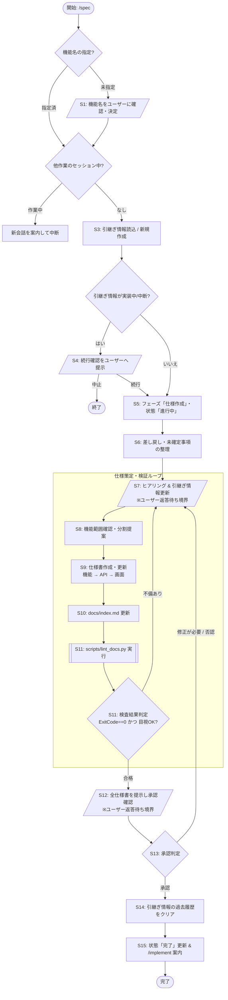

# 仕様作成

対象: $ARGUMENTS

## 全体フロー

## 対話・行動プロトコル（誤認防止ルール）

1. **現在ステップ宣言**: ユーザーへメッセージを返すときは、冒頭に必ず `[Step: S番号 (ステップ名)]` を明記すること（例: `[Step: S7 (ヒアリング)]`）。
2. **停止境界（Barrier）の遵守**: `[/ ... /]` で示された対話ノード（S1, S4, S7, S12）では、ユーザーへの質問・提示を出力した時点でターンを終了し、ユーザーの返答を待つこと。ユーザーの返答がないまま後続ステップを独断で進めてはならない。
3. **客観的エビデンスの義務化**: S11 では必ずツール実行（`run_command`）で `./scripts/lint_docs.py` を実行し、その終了コードが 0 であることを確認すること。ツールを実行せずに S12 へ進むことを禁ずる。
4. **副次成果物の同期**: 仕様書（`docs/`）の作成・変更時は、必ず引継ぎ情報（`docs/ai/<feature>.md`）の決定事項・未確定事項と整合させて同時に更新すること。

## 各ステップの実行規約

### 準備・状態確認 (S1〜S6)

- **S1 (機能名確認)**: 未指定のときは、ユーザーに機能名を確認する。新規の機能は、機能名の命名規則に従ってユーザーと決める。
- **S2 (セッション確認)**: このセッションで他の機能やフェーズの作業をしているときは、新しい会話(コンテキストの初期化)を案内して、中断する。
- **S3 (引継ぎ情報確認)**: `./docs/ai` に対象機能の引継ぎ情報があれば読み込む。なければ `./docs/_template/handover.md` から作成する。
- **S4 (実装・評価状態確認)**: 引継ぎ情報のフェーズが「実装・評価」で状態が「進行中」「中断」のときは、「完了時に中断欄、実装・評価のタスク、実行履歴、回数が消える」ことを伝えて、続行するかユーザーに確認する。続けないなら終了する。
- **S5 (状態更新)**: 引継ぎ情報のフェーズを「仕様作成」、状態を「進行中」にする。
- **S6 (未確定事項整理)**: 引継ぎ情報に差し戻し事項や未確定事項があれば、ユーザーとすり合わせる。

### 仕様策定・検証ループ (S7〜S11)

- **S7 (ヒアリング & 引継ぎ情報更新)**: ユーザーから必要な情報を聞き取る。決まった内容は決定事項として引継ぎ情報に随時記載する。解決した未確定事項は状況を「確認済」にする。
- **S8 (機能範囲確認・分割提案)**: 機能の範囲をユーザーと確認する。利用者の目的が複数あるとき、または他の機能と共有する状態・規則があるときは機能の分割を提案する(規模では分割しない)。
- **S9 (仕様書作成・更新)**: `./docs/_template` のテンプレートを使用して作成・更新する。
  - **対象**: 機能仕様書と、関連画面・関連 API に記載した仕様書。
  - **作成順**: 機能仕様書(見た目と文言を書かない) → API 仕様書(エラーの種類) → 画面仕様書(文言・表示)。相互リンクを記載する。
  - **既存仕様書**: 更新する。画面・API 仕様書の関連機能欄を確認し、他機能に影響するときはユーザーに伝える。
  - **新規仕様書**: 作成する。画面名はユーザーと決める。ダイアログは親画面とは別の画面仕様書にする。
  - **参照原則**: 他の資料に書いた内容は再掲せず、`<名前>#<項目>` で参照する。
- **S10 (インデックス更新)**: 作成・更新した画面・機能の仕様書を対象とし、画面遷移図と機能関連図も含めてインデックスファイル(`docs/index.md`)を更新する。API 仕様書は対象外とする。
- **S11 (完成度検査: コマンド実行 & 目視)**: 次のすべてを満たすか判定する。いずれかに不備がある場合は **S7** に戻る。
  - `./scripts/lint_docs.py` を実行し、エラーなく正常終了する（Exit Code 0）。
  - 引継ぎ情報の未確定事項に、状況が「未確認」の項目が残っていない。
  - 仕様書にテンプレートの記入例、選択肢の列挙(例: 「必須、任意」)、プレースホルダ(`<...>`)、注釈(`<!-- -->`)が残っている(本文として意図した記載は除く)。
  - 機能・画面・API の間で同じ内容が重複していない（目視確認）。

### 承認・完了 (S12〜S15)

- **S12 (承認提示)**: 作成・更新した仕様書のすべてをユーザーに提示し、承認を求める。
- **S13 (承認判定)**:
  - 承認されなければ、指摘内容を確認して **S7** に戻る。
  - 承認されたら **S14** に進む。
- **S14 (履歴クリア)**: 引継ぎ情報の差し戻し事項、中断欄、実装・評価のタスク、実行履歴、回数をクリアする。
- **S15 (完了更新 & 案内)**: 引継ぎ情報の概要、関連資料、引継ぎ(引継ぎ元、最初にやること)を更新し、状態を「完了」にして終了する。次のフェーズとして、新しい会話(コンテキストの初期化)で `/implement <feature-name>` を実行するよう案内する。

## 承認の取り方

- 「承認」と「修正が必要」の選択肢で確認する。
- 選択肢以外の曖昧な返答は、承認とみなさず、選択肢で再確認する。

## 中断の手順

ユーザーが中断を指示したときは、次の手順で中断する。

1. 引継ぎ情報の状態を「中断」にする。
2. 中断欄に、理由・再開位置・作業中の変更を記載する。
3. 未確定事項と決定事項を、最新の状態にする。

## 禁止事項

- 仕様が中途半端な状態で、実装・評価フェーズに進まない。
- 不明な値を、仮値で埋めて進めない。
- `./scripts/lint_docs.py` の実行・合格なしに、承認（S12）を求めない。
- ユーザーの承認なしで、状態を「完了」にしない。
