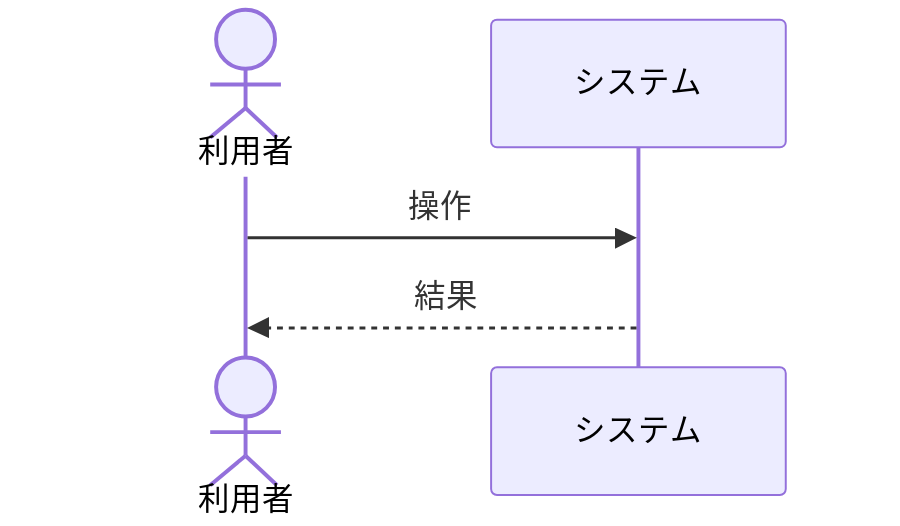

# <ファイル名（拡張子含まない）>

<!-- 【作成規則】
     1. ファイル名は機能を表す英単語を `-` で繋げた名前(例: working-copy-list)にする。機能は利用者の目的ごとに分ける。
     2. 機能仕様書には UI 用語(画面、ボタン、ダイアログ、クリック、メッセージ等)や見た目・文言、API の入出力を書かない(登場者は利用者・システム・外部システムのみ)。
     3. 他の資料に書いた内容は再掲せず `<名前>#<項目>` で参照する。
     4. 完成時はすべての注釈(`<!-- -->`)およびプレースホルダ(`<...>`)を削除または実際の記述に置き換える。選択肢(「必須、任意」等)はいずれか 1 つを選択し、不要な選択肢やカンマは削除する。
     5. 該当なし・不要な項目(入力、出力、状態遷移など)は、見出しごと削除する。 -->

## 概要

<!-- 利用者の目的と機能の概要を簡潔に書く。 -->
- <概要を簡潔に記述>

## 関連画面

<!-- この機能を提供する画面資料の Markdown リンク(例: [working-copies](../screens/working-copies.md))。複数ある場合は列挙する。 -->
- <画面資料リンク>

## 関連 API

<!-- この機能が使用する API 資料の Markdown リンク(例: [working-copy-list-load](../apis/working-copy-list-load.md))。複数ある場合は列挙する。 -->
- <API資料リンク>

## 振る舞い

<!-- 登場者は、利用者・システム・外部システム(svn など)のみ。画面は登場させない。
     状態遷移を持つ機能は、ここに `### 状態遷移` を設け Mermaid(stateDiagram-v2) または表で定義する。状態名には空白を含めない。状態遷移を持たない機能は `### 状態遷移` を設けない(見出しごと削除する)。 -->

## 入力

<!-- 利用者がシステムに与える値。画面の項目名ではなく、業務の用語で書く。
     区分列は「必須」「任意」のいずれか 1 つを選択する。
     入力がない機能は、見出し(`## 入力`)ごと削除する。 -->

|区分|項目|内容|制約|
|---|---|---|---|
|必須、任意|<項目名>|<内容>|<制約(例: 最大文字数、形式など)>|

## 出力

<!-- システムが利用者に提供する結果・情報。画面の項目名ではなく、業務の用語で書く。
     区分列は「必須」「任意」のいずれか 1 つを選択する。
     出力がない機能は、見出し(`## 出力`)ごと削除する。 -->

|区分|項目|内容|制約|
|---|---|---|---|
|必須、任意|<項目名>|<内容>|<制約(例: 最大文字数、形式など)>|

## 業務規則

<!-- 規則名は、他の資料から `<機能名>#<規則名>` で参照される。空白を含めない。
     区分には、ルールの種別(例: 正常系、判定、排他、状態更新 など)を記載する。 -->

|区分|規則|振る舞い|補足|
|---|---|---|---|
|<区分>|<規則名>|<振る舞い>|<補足>|

## 異常規則

<!-- 状況と、システムの振る舞い(拒否・状態の更新など)を書く。エラーの文言は画面資料が持つためここでは書かない。
     状況名は、画面資料のメッセージ表から `<機能名>#<状況名>` で参照される場合があるため空白を含めない。
     区分には、ルールの種別(例: 異常系、前提違反、競合 など)を記載する。 -->

|区分|状況|振る舞い|補足|
|---|---|---|---|
|<区分>|<状況名>|<振る舞い>|<補足>|
