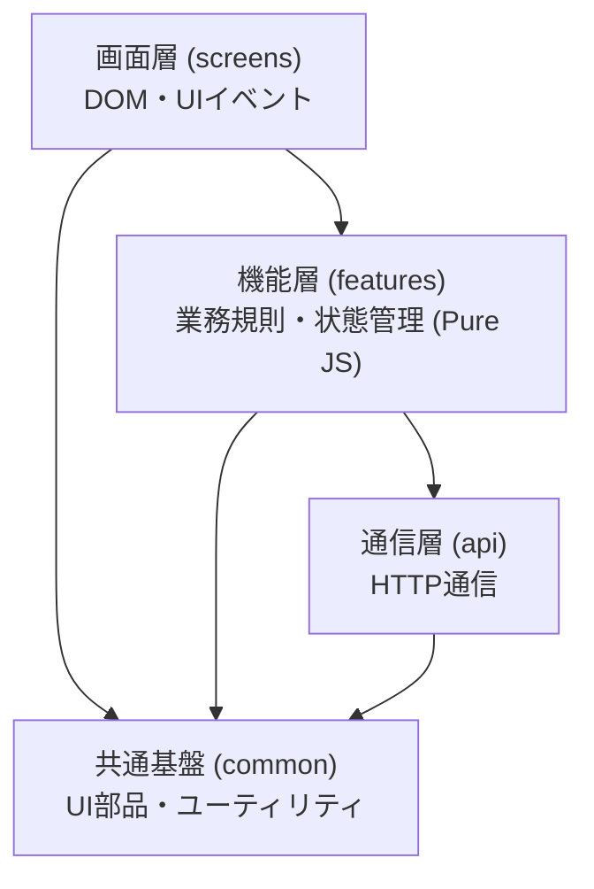
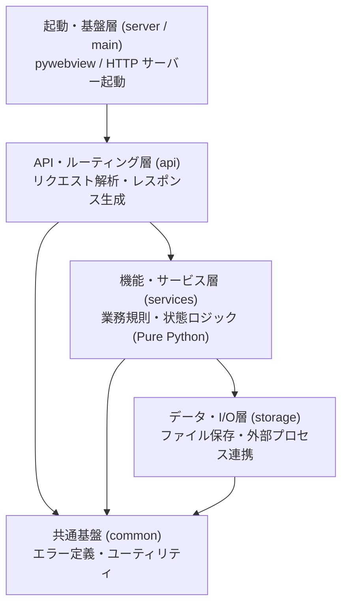

# app

## 概要

`Lumina`は Web およびデスクトップ向けのミニマルで直観的な個人の財務を管理するためのアプリケーションです。

## 目的

直観的なダッシュボードによる財務分析を通じて**貯蓄を最大化（資産形成を加速）すること**を主目的とする。

- **ダッシュボード分析と貯蓄最大化**: 日々の収支や支出傾向を直感的に可視化し、無駄な支出を削減して貯蓄を継続的に増やしていく仕組みを提供する（将来的な機能拡張も見据えた拡張性を持たせる）。
- **デスクトップ & Web マルチプラットフォーム**: 自宅の PC（デスクトップ）でも出先のブラウザ（Web）でも、同一の財務データに安全かつシームレスにアクセス・操作可能にする。
- **Google エコシステム & Gemini Pro の安全な活用**: Google AI Pro プラン（Google Cloud 月次クレジットと常時無料枠）を最大限活用し、安全なクラウド同期（Cloud Firestore）とプライバシー保護された Gemini Pro による高精度な財務・貯蓄アドバイスを実現する。
- **徹底した高額請求・セキュリティ対策**: 厳格なアクセス制御（本人認証）、API クォータ制限（ハードリミット）、予算アラートおよび自動停止（キルスイッチ）により、不正アクセスや想定外の高額請求リスクを物理的・システム的に排除する。

## 制約

### UI / UX

- Frontend は、モダンで使いやすい UI を提供する。
- Frontend は、キー操作やマウス操作に対応した直感的な UI を提供する。

### アーキテクチャ

- Web およびデスクトップで共通化するため、Frontend と Backend の連携は HTTP / HTTPS を用いる。
- Frontend は、CDN など外部リソースを読み込まず、ローカルに同梱する。

### 開発環境

- Backend は、`.venv` で依存関係を隔離して管理する。

### 評価方針

- 評価は、ローカル環境のみで完結させる（外部ネットワークへの接続を必要としない）。
- 自動テストを実施する（実行手順や環境規則は AGENTS.md に従う）。

## スタック

### Frontend

- HTML
- CSS
- JavaScript

### Backend

- Python
	- pywebview
	- pyinstaller
	- pytest(評価用)
	- playwright(評価用)

## ソフトウェア構造

### Frontend

#### 設計原則

AI による自律的なコード生成・編集・テストを高速かつ安定して行うため、以下の原則に従う。

| 原則 | 内容・規約 |
|---|---|
| 仕様書との 1:1 対応 | 仕様書（`screens/`, `features/`, `apis/`）と配置・命名を直結させ、AI が実装・編集対象を一意に特定可能にする。 |
| ファイルサイズの抑制 | 1 ファイルあたり 150〜300 行を目安とし、AI のコンテキスト消費と差分編集の失敗を防ぐ。 |
| ビルドレス & 標準技術 | バンドラやトランスパイラを排し、ブラウザ標準の ES Modules を採用する。 |
| ヘッドレス（DOM 非依存）ロジック | 機能層（`features/`）を Pure JS とし、全業務規則・状態遷移をブラウザ非起動の高速な単体テストで網羅可能にする。 |
| 画面の直接起動と状態注入 | 任意の画面・ダイアログを URL パラメータ等で直接単体描画可能とし、Playwright の画面遷移ステップ数を極小化する。 |
| モック前提（Mock-First）通信 | 通信層（`api/`）はモック差し替え可能とし、Playwright 実行時は仕様書のレスポンス例を即座に返し待機時間をゼロにする。 |
| 機械的検証可能性（Lintable） | 一方向の依存関係と命名規約を徹底し、違反をスクリプトで検知可能にする。 |

#### レイヤ構造と責務

上位層から下位層へのみ依存を許可し、逆方向の依存や循環参照を禁止する。



| 層 | 配置パス | 対応仕様書 | 主な責務・規約 |
|---|---|---|---|
| 画面層 | `src/frontend/screens/<screen-name>/` | `docs/screens/<screen-name>.md` | HTML 断片、表示切替、DOM イベント処理（業務ロジックや直接通信は持たない）。項目には `data-testid="<screen-name>--<item-name>"` を付与する。 |
| 機能層 | `src/frontend/features/<feature-name>/` | `docs/features/<feature-name>.md` | 業務規則、状態管理、入力検証（DOM 非依存の Pure JS）。 |
| 通信層 | `src/frontend/api/` | `docs/apis/<api-name>.md` | HTTP リクエスト生成、レスポンス解析、エラー型変換。モック差し替え対応。 |
| 共通基盤層 | `src/frontend/common/` | - | 共通 UI 部品（ダイアログ等）、通信クライアント基盤、汎用ユーティリティ。 |

### Backend

#### 設計原則

AI による自律的なコード生成・編集・テストを高速かつ安定して行うため、以下の原則に従う。

| 原則 | 内容・規約 |
|---|---|
| 仕様書との 1:1 対応 | API 仕様書（`apis/`）および機能仕様書（`features/`）と配置・命名を直結させ、AI が実装対象を一意に特定可能にする。 |
| ファイルサイズの抑制 | 1 ファイルあたり 150〜300 行を目安とし、AI のコンテキスト消費と差分編集の破綻を防ぐ。 |
| 標準ライブラリ主義 | 外部 Web フレームワークに依存せず、Python 標準ライブラリ（`http.server` 等）のみでミニマルに構成し、依存競合を排除する。 |
| ヘッドレス（HTTP 非依存）ロジック | サービス層（`services/`）を Pure Python とし、HTTP サーバーを介さず `pytest` でミリ秒単位で直接単体検証可能にする。 |
| モック容易性（I/O の境界分離） | ファイル・外部連携等の I/O はストレージ層（`storage/`）に隔離し、テスト時にインメモリやモックへ即座に差し替え可能にする。 |
| 機械的検証可能性（Lintable） | ルーティング層からサービス層、データ層への一方向依存を徹底し、循環参照を禁止する。 |

#### レイヤ構造と責務

上位層から下位層へのみ依存を許可し、逆方向の依存や循環参照を禁止する。



| 層 | 配置パス | 対応仕様書 | 主な責務・規約 |
|---|---|---|---|
| 起動・基盤層 | `src/backend/server.py`, `main.py` | - | アプリケーション起動、pywebview ウィンドウ生成、ローカル HTTP サーバーのライフサイクル管理。 |
| API・ルーティング層 | `src/backend/api/` | `docs/apis/<api-name>.md` | HTTP パスルーティング、クエリ/ボディ検証、HTTP ステータス・レスポンス JSON 生成。業務ロジックは持たずサービス層へ委譲。 |
| 機能・サービス層 | `src/backend/services/<feature-name>/` | `docs/features/<feature-name>.md` | 業務規則、状態管理、計算（HTTP 非依存の Pure Python）。 |
| データ・I/O層 | `src/backend/storage/` | - | ローカルファイル読み書き、外部プロセス実行等の実 I/O 処理。 |
| 共通基盤層 | `src/backend/common/` | - | 共通エラー型、HTTP 例外ハンドラ、共通ヘルパー。 |

## ディレクトリ

```
Root
├─ .agents
├─ docs                      # 仕様書
│  ├─ _template               # テンプレートファイル
│  ├─ features                # 機能仕様書（./docs/_template/feature.md をテンプレートとして使用）
│  │  └─ <feature-name>.md
│  ├─ screens                 # 画面仕様書（./docs/_template/screen.md をテンプレートとして使用）
│  │  └─ <screen-name>.md
│  ├─ apis                    # API 仕様書（./docs/_template/api_http.md をテンプレートとして使用）
│  │  └─ <api-name>.md
│  ├─ index.md                # インデックスファイル
│  └─ app.md                  # 本資料
├─ src                       # ソースコード
│  ├─ frontend
│  │  ├─ index.html          # エントリポイント
│  │  ├─ app.js              # アプリ初期化・マウント・ルーティング
│  │  ├─ app.css             # グローバルスタイル
│  │  ├─ screens/            # 画面層 (docs/screens/ に対応)
│  │  │  └─ <screen-name>/
│  │  │     ├─ <screen-name>.html
│  │  │     ├─ <screen-name>.js
│  │  │     └─ <screen-name>.css
│  │  ├─ features/           # 機能層 (docs/features/ に対応)
│  │  │  └─ <feature-name>/
│  │  │     └─ <feature-name>.js # 業務規則・状態管理 (Pure JS)
│  │  ├─ api/                # 通信層 (docs/apis/ に対応)
│  │  │  ├─ client.js        # fetch ラッパー
│  │  │  └─ <api-name>.js    # 個別 API クライアント関数
│  │  └─ common/             # 共通基盤層
│  │     ├─ components/      # 共通 UI 部品
│  │     └─ utils/           # 汎用ヘルパー
│  └─ backend                # Backend
│     ├─ main.py             # デスクトップエントリポイント (pywebview)
│     ├─ server.py           # HTTP サーバー起動・ルーティング登録
│     ├─ api/                # API・ルーティング層 (docs/apis/ に対応)
│     │  └─ <api-name>.py    # リクエスト検証・ハンドラ
│     ├─ services/           # 機能・サービス層 (docs/features/ に対応)
│     │  └─ <feature-name>/
│     │     └─ <feature-name>.py # 業務規則・状態管理 (Pure Python)
│     ├─ storage/            # データ・I/O層 (ファイル保存等)
│     └─ common/             # 共通基盤層 (エラー定義・ヘルパー)
├─ tests                     # テストコード
│  ├─ conftest.py             # 共通の fixture(設定・管理ファイル・API モック)
│  ├─ backend                 # Backend のテスト(pytest)
│  │  └─ test_<feature_name>.py
│  └─ ui                      # Frontend のテスト(playwright)
│     └─ test_<feature_name>.py
├─ scripts                   # 環境整備・ビルド・テスト・検査
└─ AGENTS.md
```
