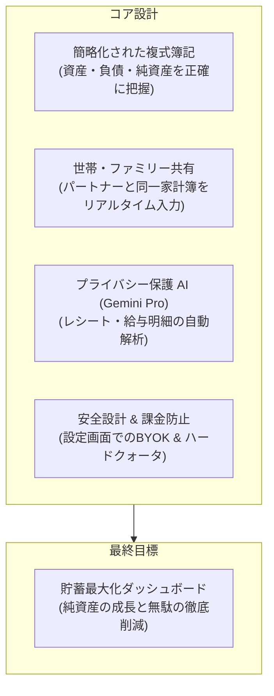

# 開発ロードマップ (Roadmap)

本書は、ユーザーが開発の全体像・優先順位・機能単位を把握し、効率的かつ段階的に開発を進行するためのガイドラインです。
各フェーズは、そのまま仕様作成（`/spec <feature-name>`）および実装（`/implement <feature-name>`）の単位となる**具体的な機能モジュール**に細分化されています。

---

## 1. コア設計思想

1. **貯蓄最大化のための「簡略化複式簿記」**:
   - 単式簿記では見えない「口座間移動」「クレジットカード未払金」「純資産の増減」を正確にトラッキング。
   - UI は「出金元」「使途/カテゴリ」を選ぶだけの直感操作で、借方・貸方の専門知識は一切不要。
2. **パートナー・家族とのシームレスな共同管理**:
   - 1 つの家計簿データをパートナー（奥さん等）と安全に共有し、双方がスマートフォン（Web）や PC（デスクトップ）から同時入力可能。
3. **プライバシー保護を徹底した Gemini Pro スマート解析**:
   - レシートや給与明細をカメラ・画像から瞬時に自動入力。
   - 氏名や口座番号などの個人情報は送信前に端末側でマスキング・保護し、データが AI 学習に利用されない安全な設定で送信。
4. **設定画面による柔軟な API 導入（BYOK: Bring Your Own Key）**:
   - 開発者だけでなく誰でも使えるよう、Gemini API キーや同期設定を画面から安全に登録・変更可能。

---

## 2. 機能別ロードマップ

---

### Phase 1: 複式簿記コア & 基本財務管理（ローカル MVP）
外部接続を必要とせず、手元のデスクトップ環境で直感的に口座と収支を管理できる堅牢な基盤を作ります。

| 機能名 (`feature-name`) | 画面 / 主な責務 | 貯蓄最大化・分析への貢献 |
| :--- | :--- | :--- |
| **`account-management`** (口座・資産管理) | 口座一覧・登録・残高調整 （現金、銀行口座、クレジットカード、電子マネー、投資口座） | 口座ごとの実残高と負債（カード未払金）を正確に把握し、真の純資産を算出可能にする。 |
| **`transaction-entry`** (直感的な複式簿記入力) | 取引入力画面 ・支出（口座 → 支出カテゴリ） ・収入（収入元 → 口座） ・振替（口座A → 口座B） | 複式簿記の整合性を保ちつつ、ユーザーは「どこから」「何に」を選ぶだけでストレスなく入力可能。 |
| **`transaction-list`** (取引明細・検索) | 取引一覧、検索、フィルター、一括編集、月別絞り込み | 日々の出費を素早く振り返り、誤った入力の修正や重複チェックを容易にする。 |
| **`app-settings`** (アプリ・API設定) | 設定画面 ・Gemini API キー登録（暗号化保存） ・表示設定、テーマ切替、データエクスポート | 誰でも手軽に自身の API キーを設定して利用開始できる基盤を作る。 |

---

### Phase 2: 貯蓄最大化ダッシュボード & 財務分析（可視化）
本アプリの最重要目的である「貯蓄を最大化するための気づき」を提供する分析画面群を構築します。

| 機能名 (`feature-name`) | 画面 / 主な責務 | 貯蓄最大化・分析への貢献 |
| :--- | :--- | :--- |
| **`dashboard-summary`** (貯蓄ダッシュボード) | ホーム画面 / メインダッシュボード ・純資産の推移グラフ ・当月の貯蓄率 & 貯蓄額 ・直近のキャッシュフロー推移 | 開いた瞬間に「今月いくら貯まったか」「資産形成のペース」が直感的に分かり、モチベーションを最大化。 |
| **`expense-analysis`** (支出・固定費分析) | 支出詳細分析画面 ・カテゴリ別内訳（円グラフ/棒グラフ） ・前月比・過去平均との比較 ・固定費 vs 変動費の比率 | 「何にお金を使いすぎているか」のボトルネック（無駄遣い）を一目で特定。 |
| **`budget-management`** (予算・貯蓄目標管理) | 予算設定・進捗管理 ・カテゴリ別予算上限 ・月間目標貯蓄額 ・超過ペース警告アラート | 支出が危険水準に達した際に早期アラートを出し、計画的な貯蓄を習慣化。 |

---

### Phase 3: クラウド同期 & ファミリー共有（デスクトップ & Web）
Google Cloud / Firebase の無料枠と月 $10 クレジットを活用し、パートナーと安全に共同利用できる環境を整えます。

| 機能名 (`feature-name`) | 画面 / 主な責務 | セキュリティ & 共有のポイント |
| :--- | :--- | :--- |
| **`auth-management`** (本人認証基盤) | ログイン・アカウント管理画面 （Google ログイン / Firebase Auth） | 安全な本人確認。パスワード流出リスクを回避。 |
| **`family-sharing`** (世帯・家族共有) | 世帯設定画面 ・家族招待リンク / 共有コード発行 ・メンバー一覧と権限管理 | パートナー（奥さんなど）と同じ家計簿に同時アクセスし、各自のスマホ・PCから支出を即時記録。 |
| **`cloud-sync`** (セキュアリアルタイム同期) | 通信・同期エンジン（バックグラウンド） ・Cloud Firestore 同期 ・オフライン入力と自動マージ | デスクトップと出先のブラウザ間で競合なくミリ秒同期。オフラインでも入力可能。 |
| **`security-guardrails`** (高額請求・不正防止防壁) | 課金保護 & クォータ監視 ・1日あたりの呼び出しハードキャップ ・月 $10 到達時の自動キルスイッチ連携 | 不正アクセスや無限ループによる**想定外のクラウド高額請求を物理的に遮断**。 |

---

### Phase 4: Gemini Pro スマート入力 & プライバシー保護解析
Google AI Pro の知能を活用し、面倒な入力を全自動化しつつ、高度な財務アドバイスを提供します。

| 機能名 (`feature-name`) | 画面 / 主な責務 | プライバシー & AI活用の特徴 |
| :--- | :--- | :--- |
| **`receipt-scanner`** (プライバシー保護レシート読取) | レシートスキャン画面 / ダイアログ ・画像アップロード / カメラ撮影 ・品目、金額、店舗、日時の自動抽出 ・事前マスキング（個人情報保護フィルター） | 店舗・購入品・支払元の複式取引を自動作成。送信前に個人情報（カード番号や氏名など）を確実に除外。 |
| **`payslip-analyzer`** (給与明細解析 & 前年比比較) | 給与明細読取・分析画面 ・基本給、残業代、社会保険料、手取りの自動構造化 ・前年同月比、昇給トレンドの推移グラフ | 「額面だけでなく実質手取りや税金がどう変化したか」を正確に把握し、貯蓄計画の精度を高める。 |
| **`ai-financial-advisor`** (Gemini 貯蓄最適化アドバイザー) | AI アドバイザー対話 / 診断画面 ・ワンクリック無駄遣い診断 ・パーソナライズされた節約アクション提案 ・将来の貯蓄シミュレーション相談 | 蓄積された複式簿記データを基に、Gemini Pro が客観的かつ高精度な節約・資産形成アドバイスを提示。 |

---

### Phase 5: 自動化 & 発展拡張
基盤完成後、さらに入力の手間を減らし、総合的な資産形成アプリへと拡張します。

| 機能名 (`feature-name`) | 画面 / 主な責務 |
| :--- | :--- |
| **`recurring-transactions`** (定期収支自動登録) | 固定費（家賃、光熱費、サブスク）や毎月の給与の自動スケジュール登録。 |
| **`csv-import-export`** (明細インポート/エクスポート) | 銀行・クレジットカードの CSV 取引明細の一括取り込み、および Google Sheets / Excel 出力。 |
| **`investment-tracking`** (資産運用推移管理) | つみたてNISA、株式、投資信託などの資産推移と家計簿を統合した総合資産ダッシュボード。 |

---

## 3. 効率的な開発の進め方（スプリント形式）

1. **1 機能 1 スプリントの原則**:
   - 各機能ごとに `/spec <feature-name>` で仕様を作成し、合意後に `/implement <feature-name>` で実装・自動テストまで完結させます。
2. **Phase 1 から着実な積み上げ**:
   - まず `account-management` → `transaction-entry` → `transaction-list` の順で実装することで、早い段階で「実際に触って動かせるアプリ」を手元で確認できます。
3. **安全第一のクラウド移行**:
   - Phase 3（クラウド・同期）に入る前に、設定画面（`app-settings`）およびセキュリティ防壁（`security-guardrails`）を整備し、安全性を 100% 担保した上でマルチユーザー化を行います。
